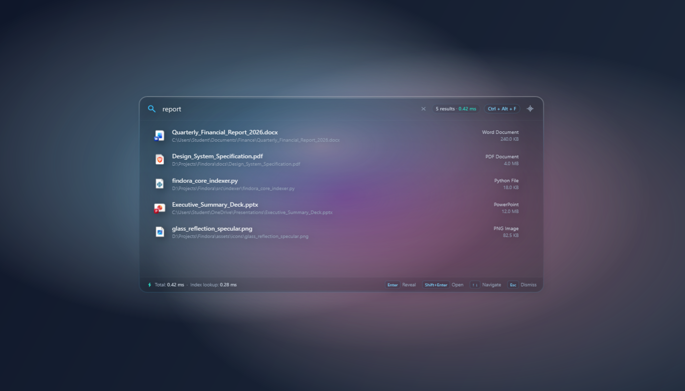
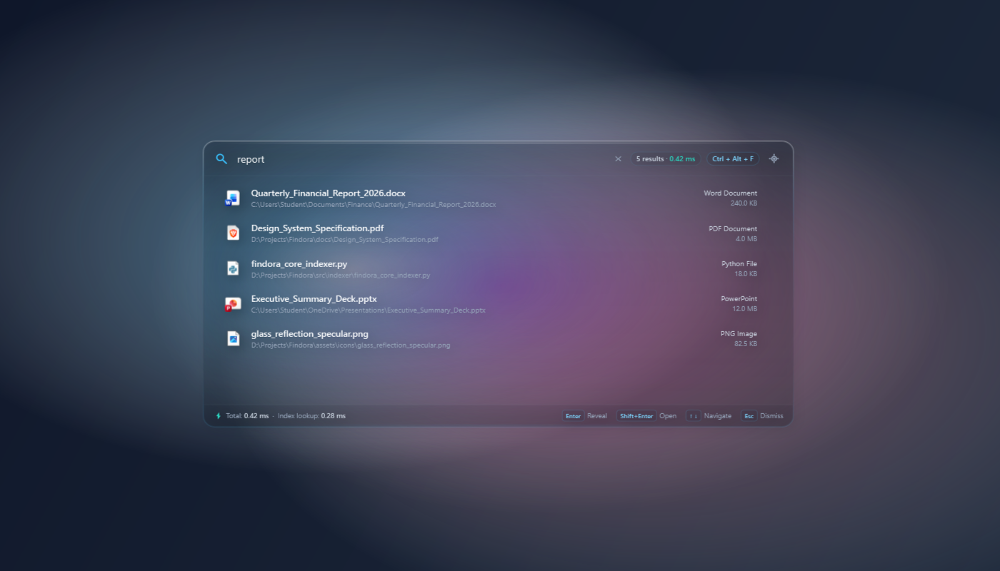
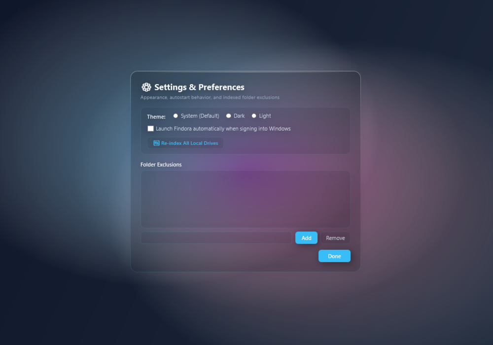
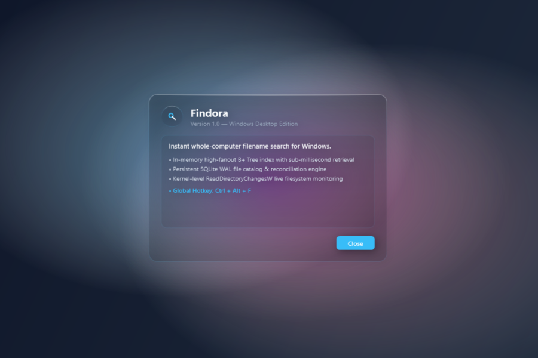
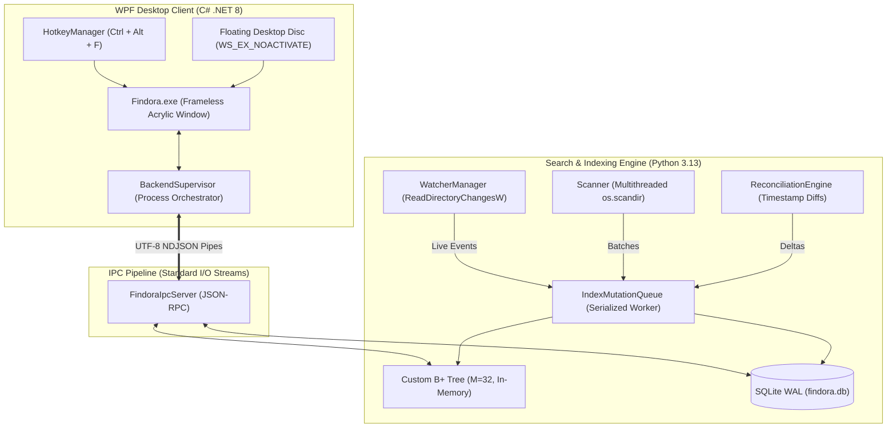
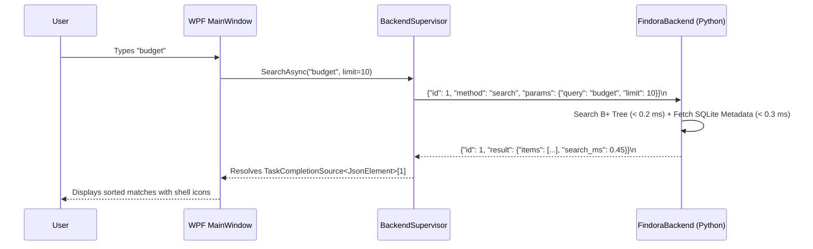

# Findora — Intelligent Desktop File Search Engine

> *"An intelligent desktop file search engine built with a custom B+ Tree indexing engine, SQLite persistence and real-time filesystem monitoring."*

[](https://github.com/aadiur/Findora/actions)
[-blue?style=flat-square&logo=windows&logoColor=white)](https://github.com/aadiur/Findora)
[](https://dotnet.microsoft.com/)
[](https://www.python.org/)
[](https://www.sqlite.org/)
[](LICENSE)
[](tests/)

---

## 1. Overview

**Findora** is a high-performance Windows desktop filename search engine engineered for instant whole-computer file discovery. It pairs a **C# .NET 8 WPF** user interface adhering to Windows 11 Fluent Glassmorphic design principles with a dedicated **Python** indexing engine powered by an in-memory **B+ Tree** and persistent **SQLite WAL** backing store.

Rather than relying on Windows Search indexer services that often consume excessive battery, disk I/O, and CPU cycles, Findora utilizes an event-driven kernel watcher (`ReadDirectoryChangesW`) and a single-threaded mutation queue. Queries run in **sub-millisecond time ($< 1\text{ ms}$)** across hundreds of thousands of files while keeping idle resource consumption near zero.

---

## 2. Download & Quick Start (Windows 10 / 11 x64)

Experience Findora immediately without setting up any development environment, Python runtime, or .NET SDK. Everything is self-contained.

### Official Releases

| Package | Format | Size | Description | Download Link |
| :--- | :---: | :---: | :--- | :--- |
| **Findora Setup Installer** | `.exe` | ~70 MB | Modern Inno Setup installer. Standard per-user install (no admin UAC required), creates Start Menu and optional Desktop shortcut. | [Findora-Setup-v1.0.0.exe](https://github.com/aadiur/Findora/releases/latest) |
| **Findora Portable Edition** | `.zip` | ~99 MB | Zero-install standalone archive. Unzip anywhere and launch `Findora.exe` directly. Ideal for USB drives or evaluation. | [Findora-v1.0.0-windows-x64.zip](https://github.com/aadiur/Findora/releases/latest) |

### SHA-256 Checksums
```text
f003be629ee35ae5f2ffbf4ebc5093dd27f0a81e1db488829b8d0f1cfced8039  Findora-Setup-v1.0.0.exe
6e31664a8dea186e4a650b7cc1bc8fa8564d45737ae28330fa5f1b685733bf5f  Findora-v1.0.0-windows-x64.zip
```

> [!NOTE]
> **Windows SmartScreen Prompt**
> Because Findora is an open-source project without an expensive commercial code-signing certificate, Windows Defender SmartScreen may display an *"Unknown Publisher"* notification on first launch. Click **More info** &rarr; **Run anyway** to proceed. You can verify the integrity of downloaded binaries using the SHA-256 checksums above.

### First-Run Experience (30 Seconds)
1. **Launch**: Open Findora from the Start Menu or run `Findora.exe`.
2. **Summon Search**: Press **`Ctrl + Alt + F`** anywhere in Windows or click the desktop search disc.
3. **Choose Folders to Index**: Click the **⚙️ Settings** icon in the search bar. Under **Indexed Folders**, click **+ Add Folder...** to select your projects, documents, or entire drives.
4. **Search Instantly**: Type any filename, partial word, extension, or typo (e.g. `databse` &rarr; `Database_Notes.pdf`). Matches appear in $< 1\text{ ms}$.
5. **Open or Reveal**: Press `Enter` to open the file in its default app, or click `Reveal` to open its containing folder in Windows File Explorer.

---

## 3. Problem Statement & Motivation

### The Problem
- **Default Windows Search Limitations**: Windows Search Indexing frequently suffers from heavy background resource consumption, disk thrashing, slow indexing updates, and inconsistent substring and extension search behavior.
- **Heavy Bloatware Tools**: Many alternative desktop search utilities either feature outdated user interfaces dating back to Windows XP, rely on heavyweight web-wrapper technologies (Electron/CEF) that consume 300+ MB of RAM at idle, or lack native Windows 11 integration.
- **Data Persistence vs. In-Memory Speed Trade-Off**: Pure in-memory search tools require complete filesystem rescans on every boot, whereas pure database-driven solutions struggle to deliver sub-millisecond prefix navigation across millions of records.

### The Motivation
Findora was designed from the ground up as a desktop systems engineering project to demonstrate:
1. **Algorithmic Elegance**: Using a tailored, memory-resident **B+ Tree** ($M=32$) for instantaneous $O(\log N + K)$ prefix range search and leaf-linked list substring scans.
2. **Reliable Hybrid Architecture**: Decoupling the UI from indexing logic via a high-throughput, private **NDJSON IPC pipeline**.
3. **Native Desktop Aesthetics**: Implementing modern Windows 11 glassmorphic acrylic/mica effects, smooth animations, and shell icon resolution without Electron overhead.
4. **Resilient Synchronization**: Real-time event tracking via `ReadDirectoryChangesW` paired with startup delta reconciliation.

---

## 4. Key Features

- **Sub-Millisecond Search Execution**: In-memory B+ Tree traversal retrieves matching files in $< 0.5\text{ ms}$ across 800,000+ files.
- **Fuzzy / Typo-Tolerant Search**: Four-stage search pipeline (exact → prefix → substring → Levenshtein fuzzy) catches common misspellings and transpositions with zero false positives for short queries.
- **Windows 11 Glassmorphism Floating UI**: Centered frameless search card with rounded corners, drop shadows, and subtle acrylic translucency.
- **Idle Desktop Search Disc**: Compact, translucent circular widget docked at the desktop boundary (`WS_EX_NOACTIVATE` / `HWND_NOTOPMOST`) that never steals focus or interferes with full-screen games/apps.
- **Configurable Folder Indexing**: Choose specific directories or drives to index directly from Settings, with instant background scan and live watcher attachment.
- **Global Hotkey Integration**: Instant summon via **`Ctrl + Alt + F`** from any application.
- **Native Shell File Icons**: Direct extraction of Windows shell icons (`SHGetFileInfoW`) with deterministic unmanaged handle destruction (`DestroyIcon`) and caching.
- **Real-Time Filesystem Monitoring**: Continuous kernel-level tracking of file additions, deletions, renames, and modifications via `ReadDirectoryChangesW`.
- **Zero Lock Contention**: Single-threaded mutation worker queue (`IndexMutationQueue`) serializing B+ Tree mutations and SQLite batch upserts.
- **Offline Startup Reconciliation**: Compares directory last-write timestamps (`st_mtime`) against last synchronization checkpoints on launch.
- **Duplicate Filename Support**: B+ Tree leaf keys map filenames to dynamic path arrays, fully indexing multiple files sharing identical names across different folders and drives.
- **Single-Instance Enforcement**: Named Win32 Mutex (`Findora_WPF_SingleInstance_Mutex_2026`) guarantees single-instance execution, restoring existing windows on duplicate launch.
- **Kernel Job Object Child Management**: Uses Windows kernel Job Objects (`KillOnJobClose`) ensuring backend background processes are terminated if the frontend exits or crashes.
- **Self-Contained Windows Distribution**: Standalone Inno Setup installer and portable ZIP with full self-contained .NET 8 runtime and PyInstaller backend — zero external runtimes needed.

---

## 5. Screenshot Gallery

### Centered Search Window (Dark & Light Modes)
| Dark Glass Theme | Light Glass Theme |
| :---: | :---: |
|  |  |

### Interactive Selection & Desktop Widget
| Result Row Selection State | Draggable Floating Desktop Widget |
| :---: | :---: |
|  |  |

### Preferences & System Information
| Settings & Drive Exclusions | About Dialog & Engine Metadata |
| :---: | :---: |
|  |  |

---

## 6. Technology Stack & Design Decisions

| Component | Technology | Rationale & Selection Criteria |
| :--- | :--- | :--- |
| **Frontend UI** | **C# .NET 8 WPF** | Native Windows desktop integration, Hardware-accelerated DirectX rendering, Win32 API access (`RegisterHotKey`, `SHGetFileInfoW`), sub-50ms startup time, and low memory footprint compared to Electron. |
| **Backend Engine** | **Python 3.13** | Rapid filesystem traversal (`os.scandir`), rich Win32 API bindings (`pywin32` / `ctypes`), rapid prototyping, and standalone compilation via PyInstaller. |
| **In-Memory Index** | **Custom B+ Tree ($M=32$)** | Predictable $O(\log N + K)$ prefix range search, sequential leaf traversal via `nextKey` pointers for substring search, and cache-friendly fanout. |
| **Catalog Storage** | **SQLite (WAL Mode)** | Zero-configuration relational persistence, atomic transactions, 32 MB page cache, and instantaneous hydration into memory on boot. |
| **IPC Channel** | **Anonymous Pipes (NDJSON)** | High throughput ($> 50\text{ MB/s}$ throughput), zero network port conflicts, immune to firewall interference, and authenticated parent-child lifecycle. |
| **Filesystem Watcher**| **`ReadDirectoryChangesW`** | Event-driven kernel notification system bypassing expensive polling; supports overlapped I/O and graceful cancellation handles. |
| **Installer** | **Inno Setup 6** | Lightweight modern Windows installer with LZMA2 ultra compression, per-user non-elevated installation, and clean uninstallation. |

---

## 7. Complete Repository Structure

```text
Findora/
├── .github/
│   ├── ISSUE_TEMPLATE/
│   │   ├── bug_report.md             # Standardized bug reporting template
│   │   └── feature_request.md        # Feature request template
│   ├── workflows/
│   │   ├── ci.yml                    # GitHub Actions CI workflow (Python & .NET)
│   │   └── release.yml               # Automated release workflow on tag push
│   └── pull_request_template.md      # Pull request submission checklist
├── assets/
│   ├── app.ico                       # Multi-resolution Windows application icon
│   ├── reference/
│   │   └── Findora-UI-Reference.png  # UI layout & component design guide
│   └── screenshots/                  # Verified genuine application captures
│       ├── liquid_mainwindow_dark_desktop.png
│       ├── liquid_mainwindow_light_desktop.png
│       ├── liquid_mainwindow_dark_rowhover_desktop.png
│       ├── liquid_widget_dark_desktop.png
│       ├── liquid_widget_light_desktop.png
│       ├── liquid_settings_dark_desktop.png
│       ├── liquid_about_dark_desktop.png
│       └── liquid_splash_dark_desktop.png
├── build/
│   ├── build_release.ps1             # 6-stage automated release packaging script
│   └── installer.iss                 # Inno Setup 6 Windows installer definition
├── docs/
│   ├── architecture.md               # Detailed architecture & Mermaid diagrams
│   ├── development.md                # Local developer setup, debugging & profiling
│   ├── installation.md               # End-user installation & system requirements
│   └── usage.md                      # Hotkey guide, operations & search syntax
├── src/
│   ├── Findora.Backend/              # Python indexing & search runtime
│   │   ├── __init__.py
│   │   ├── app.py                    # High-level backend application coordinator
│   │   ├── gui.py                    # Standalone Tkinter UI fallback
│   │   ├── icon_provider.py          # Shell icon extraction utility
│   │   ├── ipc_server.py             # NDJSON JSON-RPC IPC server
│   │   ├── main.py                   # Central CLI / IPC / daemon entry point
│   │   ├── queue_manager.py          # Thread-safe serialized mutation queue
│   │   ├── reconciler.py             # Startup offline delta reconciliation engine
│   │   ├── scanner.py                # Multithreaded whole-drive crawler
│   │   ├── storage.py                # SQLite WAL storage manager & locations table
│   │   ├── system_integration.py     # Autostart, single-instance mutex & tray
│   │   ├── tree.py                   # Custom thread-safe B+ Tree with Levenshtein fuzzy search
│   │   └── watcher.py                # ReadDirectoryChangesW overlapped I/O watcher
│   ├── Findora.Ipc/                  # IPC protocol documentation & specifications
│   │   └── protocol_spec.md
│   └── Findora.Wpf/                  # Modern C# .NET 8 WPF Desktop Client
│       ├── Findora.Wpf.csproj        # WPF project configuration with app icon
│       ├── App.xaml / .cs            # Application bootstrap & mutex enforcement
│       ├── Models/
│       │   ├── IpcMessages.cs        # Request/response JSON-RPC data models
│       │   └── SearchResultItem.cs   # Data-bound search result model with formatting
│       ├── Services/
│       │   ├── AutostartHelper.cs    # Windows Run registry configuration
│       │   ├── BackendSupervisor.cs  # Subprocess manager & async IPC client
│       │   ├── FileActionService.cs  # Shell open & explorer reveal operations
│       │   ├── FileIconService.cs    # SHGetFileInfoW icon extraction & caching
│       │   ├── HotkeyManager.cs      # Win32 RegisterHotKey integration
│       │   ├── JobObjectTracker.cs   # Win32 Job Object (KillOnJobClose child supervisor)
│       │   ├── LiquidGlassController.cs # Window backdrop & acrylic effect helper
│       │   ├── ThemeManager.cs       # Dark/Light theme switching
│       │   ├── TrayIconService.cs    # System tray icon and context menu
│       │   └── WindowBackdropHelper.cs
│       ├── Themes/
│       │   ├── DarkTheme.xaml        # Fluent dark glass resource dictionary
│       │   └── LightTheme.xaml       # Fluent light glass resource dictionary
│       └── Views/
│           ├── AboutDialog.xaml / .cs
│           ├── DesktopWidget.xaml / .cs
│           ├── MainWindow.xaml / .cs
│           ├── SettingsDialog.xaml / .cs # Folder selection & exclusion preferences
│           └── SplashWindow.xaml / .cs
├── tests/
│   ├── dotnet/
│   │   └── Findora.Wpf.Tests/        # xUnit test suite for WPF services (12 tests)
│   │       ├── Findora.Wpf.Tests.csproj
│   │       └── UnitTest1.cs
│   └── python/                       # Pytest unit & integration suite (120 tests)
│       ├── test_end_to_end.py
│       ├── test_floating_widget.py
│       ├── test_fuzzy_search.py      # Fuzzy search & Levenshtein unit tests (55 tests)
│       ├── test_icon_provider.py
│       ├── test_ipc.py
│       ├── test_queue_manager.py
│       ├── test_scanner.py
│       ├── test_storage.py
│       ├── test_system_integration.py
│       ├── test_tree.py
│       ├── test_ui_redesign_and_input.py
│       └── test_watcher_and_reconciler.py
├── tools/
│   ├── VisualInspector/              # Diagnostic WPF visual tree inspection tool
│   └── generate_benchmark_files.py   # Synthetic high-volume benchmark data generator
├── .gitignore                        # Comprehensive multi-language ignore rules
├── CHANGELOG.md                      # Keep a Changelog semantic version history
├── CODE_OF_CONDUCT.md                # Contributor Covenant Code of Conduct
├── CONTRIBUTING.md                   # Contribution workflow & guidelines
├── Findora.sln                       # Unified Visual Studio 2022 Solution
├── LICENSE                           # MIT License
├── README.md                         # Product documentation & technical guide
├── requirements.txt                  # Production Python dependencies
└── requirements-dev.txt              # Development & testing Python dependencies
```

---

## 8. Architecture & System Design



For complete technical specifications, sequence diagrams, and concurrency flowcharts, consult [docs/architecture.md](docs/architecture.md).

---

## 9. How the Search Engine Works

### 9.1 Custom B+ Tree Implementation (`src/Findora.Backend/tree.py`)
- **Structure**: High-fanout B+ Tree with order $M = 32$.
- **Leaf Organization**: Leaf nodes store arrays of sorted filename keys and corresponding path arrays.
- **Linked Leaves**: Leaves maintain a unidirectional pointer (`nextKey`), linking all leaves into a sorted continuous sequence.
- **Prefix Range Scans**: In $O(\log N)$ time, Findora navigates to the first leaf containing `prefix`, then walks `nextKey` pointers directly in $O(K)$ time without returning up through internal nodes.
- **Four-Stage Query Strategy**:
  1. **Exact Matches**: Returns filenames strictly matching the query case-insensitively.
  2. **Prefix Matches**: Evaluates filenames that begin with the query string.
  3. **Substring Matches**: Evaluates filenames containing the query anywhere in their name.
  4. **Fuzzy Matches**: Levenshtein edit-distance scan over leaf chain, with length-based early termination and dynamic thresholds (max distance 1 for ≤4 chars, 2 for ≤8 chars, 3 otherwise). Queries shorter than 3 characters bypass the fuzzy stage entirely to suppress noise. Results are ranked by ascending edit distance and deduplicated against earlier stages.

> **Example fuzzy queries** — after indexing `Database_Notes.pdf`, `Machine_Learning.pdf`:
>
> | Query | Matched Filename | Edit Distance |
> |---|---|---|
> | `Databse_Notes.pdf` | `Database_Notes.pdf` | 1 (deletion) |
> | `Databasee_Notes.pdf` | `Database_Notes.pdf` | 1 (insertion) |
> | `Databese_Notes.pdf` | `Database_Notes.pdf` | 1 (substitution) |
> | `Machine_Learnng.pdf` | `Machine_Learning.pdf` | 1 (deletion) |

### 9.2 SQLite Persistence & WAL Mode (`src/Findora.Backend/storage.py`)
- Stored at `%LOCALAPPDATA%\Findora\findora.db`.
- Configured with `PRAGMA journal_mode = WAL` and `PRAGMA synchronous = NORMAL`.
- Manages `indexed_locations` table for folder selection preferences.
- On startup, `load_all_records_for_tree()` streams file records in 10,000-row chunks directly into memory, hydrating 800,000+ files into the B+ Tree in under 3 seconds.

### 9.3 Real-Time Monitoring & Mutation Serialization (`src/Findora.Backend/watcher.py`)
- Registers directory monitoring handles using Win32 `ReadDirectoryChangesW` with overlapped I/O.
- Catches OS events: `FILE_ACTION_ADDED`, `FILE_ACTION_REMOVED`, `FILE_ACTION_MODIFIED`, `FILE_ACTION_RENAMED_OLD_NAME`, `FILE_ACTION_RENAMED_NEW_NAME`.
- All events are enqueued into `IndexMutationQueue`, which flushes in batches every 200 ms. This eliminates write lock contention on SQLite and prevents race conditions in the B+ Tree.

---

## 10. IPC Architecture & Request Flow

Communication between the C# frontend and Python backend runs over redirected standard input/output pipes using **Newline-Delimited JSON (NDJSON)**.



---

## 11. Developer Guide & Build Instructions

### 11.1 Prerequisites
- **Operating System**: Windows 10 (19041+) or Windows 11 (64-bit).
- **.NET SDK**: [.NET 8.0 SDK](https://dotnet.microsoft.com/download/dotnet/8.0).
- **Python**: [Python 3.10+](https://www.python.org/downloads/) (64-bit).
- **Inno Setup 6**: [Inno Setup 6](https://jrsoftware.org/isinfo.php) (for installer packaging).
- **PowerShell**: 5.1 or 7+.

### 11.2 Clone & Set Up Development Environment
```powershell
# 1. Clone the repository
git clone https://github.com/aadiur/Findora.git
cd Findora

# 2. Set up Python virtual environment
python -m venv .venv
.\.venv\Scripts\Activate.ps1
python -m pip install --upgrade pip
python -m pip install -r requirements-dev.txt

# 3. Restore .NET solution
dotnet restore Findora.sln
```

### 11.3 Run in Development Mode
```powershell
# Launch the WPF client (automatically supervises Python backend via IPC)
dotnet run --project src\Findora.Wpf\Findora.Wpf.csproj
```

### 11.4 Run Verification Tests
```powershell
# Run Python backend test suite (120 tests)
python -m pytest tests/python -q --tb=short

# Run .NET WPF test suite (12 tests)
dotnet test Findora.sln -c Release
```

### 11.5 Automated Release Packaging
To assemble the full production release suite (quality gate tests, PyInstaller backend, self-contained WPF, Inno Setup installer, portable ZIP, and SHA-256 checksums):
```powershell
powershell -ExecutionPolicy Bypass -File build\build_release.ps1
```
The output directory will contain:
- `dist\Findora-Setup-v1.0.0.exe` (Standalone Windows Installer ~70 MB)
- `dist\Findora-v1.0.0-windows-x64.zip` (Portable ZIP package ~99 MB)
- `dist\SHA256SUMS.txt` (Cryptographic verification checksums)
- `dist\Findora\` (Unpacked application folder with `Findora.exe` and `backend\FindoraBackend.exe`)

---

## 12. Known Limitations & Roadmap

### Known Limitations
- **Platform Scope**: Findora is engineered specifically for Windows (NTFS / FAT32) due to its dependency on `ReadDirectoryChangesW`, Win32 Shell Icons (`SHGetFileInfoW`), and WPF.
- **Content Search**: Findora indexes filenames, extensions, and metadata; it does not perform full-text file body content indexing.
- **Network Drives (UNC)**: Network and cloud virtual shares (OneDrive/Google Drive on-demand files) are supported if mounted, but may exhibit delayed `ReadDirectoryChangesW` event notifications depending on network driver caching.

### Future Roadmap
- [x] **Fuzzy Search (Levenshtein)** — Four-stage search with typo tolerance implemented; dynamic thresholds, early termination, and full deduplication.
- [x] **Configurable Folder Indexing** — Support custom folder selection and live dynamic watcher attachment.
- [x] **Self-Contained Windows Release** — Inno Setup installer and portable ZIP distribution with Job Object process management.
- [ ] **Content-Type Filter Tags**: Quick filter chips (`type:pdf`, `type:doc`, `type:media`, `size:>100MB`).
- [ ] **Regular Expression Query Support**: Full regex syntax parsing for advanced filename patterns.
- [ ] **Everything / USN Journal Integration**: Optional Windows NTFS USN (Update Sequence Number) Journal parser for initial indexing in $< 1\text{ second}$.

---

## 13. Contribution Guidelines

Contributions, pull requests, and feedback are warmly welcomed! Please read our [CONTRIBUTING.md](CONTRIBUTING.md) and [CODE_OF_CONDUCT.md](CODE_OF_CONDUCT.md) before submitting patches.

---

## 14. License

This project is licensed under the **MIT License**. See the [LICENSE](LICENSE) file for complete details.

---

## 15. Author & Acknowledgments

- **Author**: [aadiur](https://github.com/aadiur)
- **Target Repository**: [https://github.com/aadiur/Findora](https://github.com/aadiur/Findora)
- **Acknowledgments**: Built with inspiration from high-performance desktop retrieval tools and modern Windows 11 Fluent design principles.
