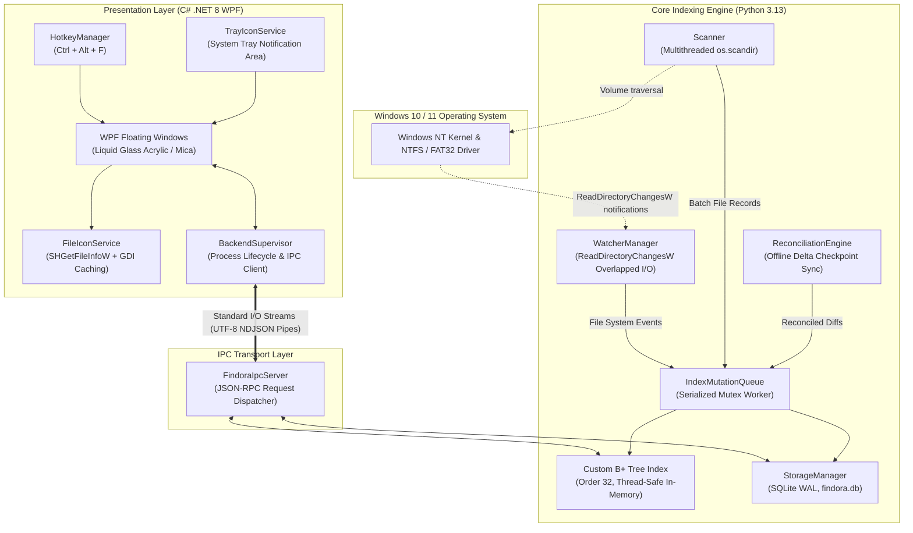
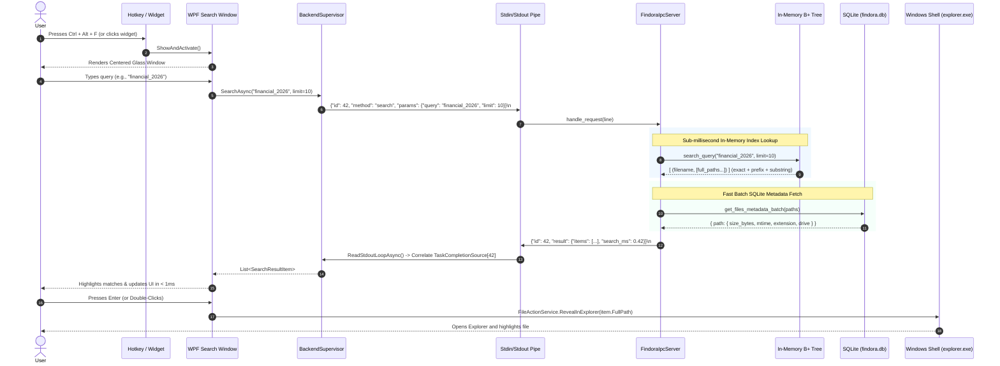
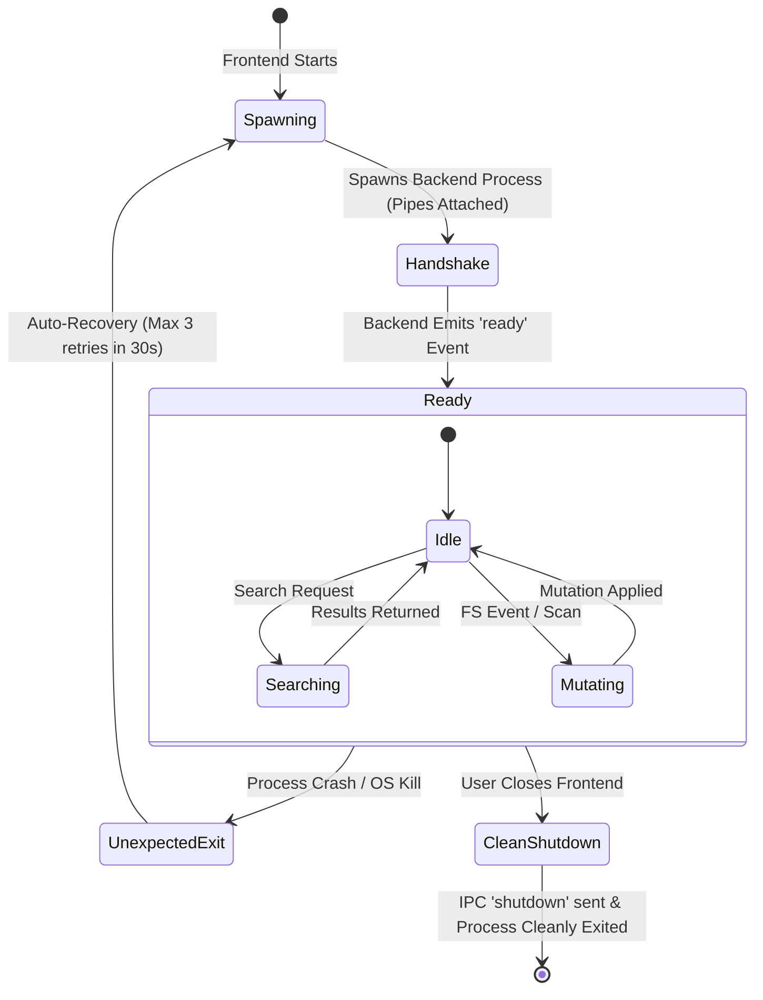

# Findora Architecture Specification

Technical architectural specification for **Findora — Intelligent Desktop File Search Engine**.

---

## 1. System Architecture Overview

Findora uses a decoupled, hybrid architecture engineered for ultra-low latency filename search on Windows. It pairs a native **C# .NET 8 WPF** graphical user interface with an in-process / managed **Python 3.13** indexing runtime. Communication occurs over an asynchronous, bi-directional JSON-Lines (NDJSON) IPC pipeline over standard anonymous pipes (`stdin` / `stdout`).



---

## 2. Core Architectural Components

### 2.1 C# .NET 8 WPF Presentation Layer (`src/Findora.Wpf`)
- **`MainWindow.xaml`**: Floating, frameless, centered search card featuring Windows 11 Fluent glassmorphism, rounded corners, soft drop shadows, and acrylic/mica translucency.
- **`DesktopWidget.xaml`**: Persistent, unobtrusive circular desktop disc docked at the screen periphery (`HWND_NOTOPMOST` / `WS_EX_NOACTIVATE`) that does not steal keyboard focus or occlude full-screen workflows.
- **`BackendSupervisor.cs`**: Subprocess orchestrator that launches either the bundled PyInstaller binary (`FindoraBackend.exe`) or development scripts (`main.py --ipc`), monitors child process health, automatically restarts crashed workers, and multiplexes JSON-RPC requests across thread-safe asynchronous completion sources (`ConcurrentDictionary<int, TaskCompletionSource<JsonElement>>`).
- **`FileIconService.cs`**: Native Windows shell icon extractor invoking Win32 `SHGetFileInfoW` with `SHGFI_USEFILEATTRIBUTES | SHGFI_ICON | SHGFI_LARGEICON`. Converted icons are frozen (`Freeze()`) and cached in a thread-safe dictionary, while native unmanaged handles are deterministically released via `DestroyIcon`.
- **`HotkeyManager.cs`**: Win32 `RegisterHotKey` listener bound to the message pump via `HwndSourceHook`, registering `MOD_CONTROL | MOD_ALT` with `VK_F` (`Ctrl + Alt + F`).
- **`SingleInstanceMutex`**: Named Win32 mutex `Findora_WPF_SingleInstance_Mutex_2026` ensuring only one frontend instance executes at any time.

### 2.2 IPC Pipeline Layer (`src/Findora.Ipc`)
- Private, authenticated parent-child process communication over `stdin` and `stdout`.
- Line-delimited JSON messages (NDJSON) encoded in UTF-8 without byte-order marks.
- Bounded concurrency with asynchronous task completion tokens correlated by monotonic integer request IDs (`id: 1, 2, ...`).
- Asynchronous unprompted notification stream for lifecycle events (`started`, `ready`, `scan_progress`, `reconcile_progress`).

### 2.3 Python Backend Engine (`src/Findora.Backend`)
- **`tree.py`**: Custom in-memory B+ Tree indexing filename keys to multi-path value lists. Leaf nodes form a doubly-navigable single-direction linked list (`nextKey`) allowing $O(\log N + K)$ prefix range scans.
- **`storage.py`**: SQLite database configured with Write-Ahead Logging (`PRAGMA journal_mode = WAL`), reduced synchronization barriers (`PRAGMA synchronous = NORMAL`), and a 32 MB page cache (`PRAGMA cache_size = -32000`).
- **`queue_manager.py`**: Thread-safe mutation queue that serializes all insert, delete, rename, and batch operations to both the in-memory B+ Tree and the persistent SQLite catalog via a single dedicated background worker thread (`Findora-MutationWorker`).
- **`watcher.py`**: Win32 `ReadDirectoryChangesW` asynchronous overlapped directory monitoring engine tracking real-time filesystem modifications (`FILE_ACTION_ADDED`, `FILE_ACTION_REMOVED`, `FILE_ACTION_MODIFIED`, `FILE_ACTION_RENAMED_OLD_NAME`, `FILE_ACTION_RENAMED_NEW_NAME`).
- **`reconciler.py`**: Startup delta reconciliation engine that compares directory last-write timestamps (`st_mtime`) against the stored `last_sync_time` checkpoint, detecting files created, modified, or removed while Findora was closed.
- **`scanner.py`**: Multithreaded drive crawler utilizing native `os.scandir` iterators for rapid initial whole-computer indexing.

---

## 3. Search Request Lifecycle

When a user triggers a search, the query flows through the entire system and returns results in sub-millisecond time.



---

## 4. Indexing and Synchronization Lifecycle

Findora maintains index consistency across computer reboots, sleep states, external drive attachments, and high-frequency filesystem changes.

```mermaid
flowchart TD
    Start([Findora Application Launch]) --> CheckDB{Database Exists?<br/>findora.db}
    
    CheckDB -- No / Empty --> FullScan[Full Computer Drive Discovery]
    FullScan --> Traverse[Multithreaded os.scandir Traversal]
    Traverse --> BatchQueue[Enqueue BATCH_ADD to IndexMutationQueue]
    
    CheckDB -- Yes --> Hydrate[Hydrate B+ Tree from SQLite Index]
    Hydrate --> ReconcileCheck[ReconciliationEngine Startup Check]
    
    ReconcileCheck --> CheckTimestamps{Directory st_mtime ><br/>last_sync_time?}
    CheckTimestamps -- Yes --> DetectDeltas[Scan Modified Directories for Deltas]
    DetectDeltas --> BatchQueue
    CheckTimestamps -- No --> WatchersInit[Initialize ReadDirectoryChangesW Watchers]
    
    BatchQueue --> Worker[IndexMutationQueue Background Worker]
    Worker --> MutateTree[Insert into B+ Tree Index]
    Worker --> MutateDB[Batch Upsert into SQLite WAL]
    MutateDB --> WatchersInit
    
    subgraph LiveMonitoring["Real-Time Live Monitoring"]
        WatchersInit --> OverlappedLoop[Overlapped ReadDirectoryChangesW Event Loop]
        OverlappedLoop --> Evt{Filesystem Event}
        Evt -- FILE_ACTION_ADDED --> EnqAdd[Enqueue ADD Mutation]
        Evt -- FILE_ACTION_REMOVED --> EnqRem[Enqueue REMOVE Mutation]
        Evt -- FILE_ACTION_RENAMED --> EnqRen[Enqueue RENAME Mutation]
        EnqAdd --> Worker
        EnqRem --> Worker
        EnqRen --> Worker
    end

    subgraph ShutdownSequence["Application Shutdown"]
        CloseSignal([App Exit Signal]) --> StopWatchers[CancelIo & CloseHandle on Watchers]
        StopWatchers --> FlushQueue[Flush Pending Mutations to SQLite]
        FlushQueue --> CheckpointWAL[PRAGMA wal_checkpoint(TRUNCATE)]
        CheckpointWAL --> Terminate([Clean Zero-Orphan Process Exit])
    end
```

---

## 5. Custom B+ Tree Engine Implementation

### 5.1 Node Hierarchy & Structural Invariants
The indexing engine in `src/Findora.Backend/tree.py` implements a memory-resident B+ Tree configured with a fanout order of $M = 32$.

- **Leaf Nodes (`check_leaf = True`)**:
  - `values`: Ascending sorted array of unique filename strings (`["annual_report.docx", "budget.xlsx"]`).
  - `keys`: Array of path arrays corresponding to each filename (`[["C:\\Docs\\annual_report.docx", "D:\\Backups\\annual_report.docx"], ["C:\\Finance\\budget.xlsx"]]`). This natively supports duplicate filenames across disparate directories without collision.
  - `nextKey`: Reference pointer to the immediate sibling leaf on the right, constructing a contiguous linked chain of all indexed leaves.
  - `lock`: Per-node threading lock protecting local value and key mutations.
- **Internal Nodes (`check_leaf = False`)**:
  - `values`: Array of separator keys of length up to $M - 1$.
  - `keys`: Array of child node references of length up to $M$.
  - `parent`: Pointer reference to the parent node.

### 5.2 Algorithmic Complexities
| Operation | Average Case | Worst Case | Space Complexity | Description |
| :--- | :--- | :--- | :--- | :--- |
| **Search (Exact)** | $O(\log_M N)$ | $O(\log_M N)$ | $O(1)$ | Tree navigation from root to target leaf via binary/linear search. |
| **Prefix Range Scan** | $O(\log_M N + K)$ | $O(\log_M N + K)$ | $O(K)$ | Locates starting leaf in $O(\log_M N)$ and traverses `nextKey` pointers for $K$ items. |
| **Substring Scan** | $O(N)$ | $O(N)$ | $O(K)$ | Sequential linked list traversal across leaf nodes without internal node re-traversal. |
| **Insert** | $O(\log_M N)$ | $O(\log_M N + M)$ | $O(1)$ amortized | Tree descent, leaf insert, and parent split propagation when node fills. |
| **Delete** | $O(\log_M N)$ | $O(\log_M N)$ | $O(1)$ | Locates leaf and removes specific path from path array. |

### 5.3 Thread-Safe Traversal Mechanism
Search operations safely traverse the leaf linked list concurrently with index updates:
1. When traversing leaves in `search_query()`, `prefix_search()`, or `substring_search()`, Findora acquires the individual leaf node lock (`with curr.lock:`).
2. It snapshots `curr.values`, `curr.keys`, and the pointer to `curr.nextKey`.
3. It releases the lock and evaluates search predicates on the snapshot.
4. It advances to `next_node`.
This prevents read-write race conditions, deadlocks, and `RuntimeError: list changed size during iteration` without locking the entire tree during multi-millisecond scans.

---

## 6. IPC Protocol Specification

### 6.1 Framing and Encoding
Findora's IPC uses **NDJSON** (Newline-Delimited JSON) over standard anonymous OS pipes:
- All messages are single-line JSON objects terminated with `\n` (ASCII 0x0A).
- Text encoding is standard UTF-8 without BOM.
- Messages must never contain embedded unescaped newlines.

### 6.2 Message Types

#### Request (Frontend $\to$ Backend)
```json
{
  "id": 101,
  "method": "search",
  "params": {
    "query": "quarterly_presentation",
    "limit": 10
  }
}
```

#### Response (Backend $\to$ Frontend)
```json
{
  "id": 101,
  "result": {
    "query": "quarterly_presentation",
    "items": [
      {
        "filename": "quarterly_presentation_q4.pptx",
        "full_path": "C:\\Users\\User\\Documents\\quarterly_presentation_q4.pptx",
        "size_bytes": 4829104,
        "mtime": 1729600000.0,
        "extension": ".pptx"
      }
    ],
    "total_matches": 1,
    "index_ms": 0.12,
    "meta_ms": 0.28,
    "total_ms": 0.40,
    "search_ms": 0.40
  },
  "error": null
}
```

#### Async Notification Event (Backend $\to$ Frontend)
```json
{
  "event": "scan_progress",
  "data": {
    "drive": "C:\\",
    "files_scanned": 412500,
    "current_path": "C:\\Program Files\\Findora"
  }
}
```

### 6.3 Supported Methods Reference
| Method | Parameters | Description |
| :--- | :--- | :--- |
| `ping` | None | Heartbeat health-check returning protocol version and server time. |
| `search` | `query: str, limit: int` | Executes multi-stage B+ Tree search and returns file metadata. |
| `status` | None | Returns drive statuses, total file count, and scanner state. |
| `rescan` | None | Triggers asynchronous whole-computer drive rescanning. |
| `reveal` | `path: str` | Selects and highlights file in Windows File Explorer via `explorer.exe /select,"path"`. |
| `open` | `path: str` | Launches file in its Windows associated application via `os.startfile`. |
| `exclusions_get` | None | Retrieves active directory exclusion patterns. |
| `exclusions_add` | `pattern: str` | Registers a new path or pattern exclusion in the persistent database. |
| `exclusions_remove`| `pattern: str` | Deletes an existing exclusion pattern. |
| `shutdown` | None | Instructs the backend to flush pending mutations, stop watchers, and cleanly exit. |

---

## 7. Process Lifecycle & Resilience



1. **Supervision**: `BackendSupervisor` handles process initialization, health verification, and clean shutdown.
2. **Crash Auto-Recovery**: If the backend process unexpectedly terminates or is killed from Task Manager, `BackendSupervisor` captures the exit code, logs the stack trace to `%LOCALAPPDATA%\Findora\logs\backend.log`, and automatically re-launches the engine transparently.
3. **Graceful Exit**: On application shutdown, the frontend dispatches a `shutdown` IPC command, flushes SQLite transactions with `PRAGMA wal_checkpoint(TRUNCATE)`, closes Win32 handles, and confirms process termination before releasing the frontend single-instance mutex.
